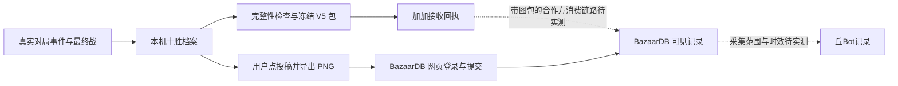

# 加加自动上传与 BazaarDB 投稿实施方案

日期：2026-10-23。基线：手机 v0.101。本文件是待实施方案，不表示上传功能已经完成。

> 2026-10-23 用户决定先搁置。v0.0.1 已改为独立包开发线，十胜自动记录开关默认关闭；下面原定的默认开启和阶段安排仅为恢复开发时的历史方案，不覆盖此次关闭要求。

目标是让真实十胜记录先可靠保存在手机，再按各站支持的方式分享。首版实现加加自动上传和 BazaarDB 用户操作的网页投稿；丘Bot继续作为推荐数据源，后续是否采入投稿记录单独验证。

## 1. 首版决策

| 通道 | 用户体验 | 实施边界 |
| --- | --- | --- |
| 本机档案 | 十胜完成后自动保存真实阵容、技能、结算信息和全屏游戏截图 | 保存完成后才显示“本机已保存”；缺数据或截图则显示具体待补项 |
| 加加 | 开关开启时，完整记录自动排队上传；失败可恢复 | 先适配当前发行 5.7.0 的 V5 契约，不把仓库 V6 当作当前发行协议 |
| BazaarDB | 在档案卡点“去 BazaarDB 投稿”，导出截图并打开官网，用户登录、选图、选英雄和完成网页验证 | 首版使用官网已有流程；个人 Tracker 写入协议未确认，不把它列为首版依赖 |
| 丘Bot | 保留现有查询和推荐；有明确 BazaarDB 记录后可检查是否已收录 | 不在手机内嵌丘Bot运营者令牌，不承诺上游投稿必然被采集 |

首版不建设中转服务器。加加走已公开的上传协议，BazaarDB走用户账号的网页投稿。



## 2. 设置与手机交互

保留现有四个顶层页签和游戏素材主题。设置中增加“社区分享”分组，档案列表从这里进入，不挤占局内推荐卡牌空间。十胜完成且画面稳定后可出现一个简短的非阻塞提示，点提示进入对应档案。

| 设置 | 新安装默认值 | 行为 |
| --- | --- | --- |
| 十胜自动记录 | 开启 | 记录真实完成的十胜档案，写入本机 |
| 加加自动上传 | 开启 | 仅发送已满足首版完整性条件的真实档案 |
| BazaarDB 投稿提醒 | 开启 | 提示存在可投稿档案；不会自动打开网页或替用户提交 |

沿用用户此前要求的默认开启。迁移现有 `companion_upload` 时，用户原先关闭的偏好映射为上述自动功能继续关闭，不能因升级恢复为开启；原先开启则迁移为开启。实现时把内部“记录”和“上传”配置拆开，兼容读取旧配置一次后保存新版本配置。

每条档案用现有游戏边框展示英雄、胜负、时间、棋盘缩略图及三条独立状态：本机、加加、BazaarDB。用户可预览原图、查看缺项、重试加加、导出截图或去 BazaarDB 投稿。点击投稿入口本身表达本次操作意图，不增加重复确认弹窗；所需登录和网页验证交给官网。

关闭加加自动上传后暂停新请求及自动重试，保留已冻结包；在途请求仍处理真实回执，避免把已发送的数据误标为“从未上传”。关闭记录不删除已保存档案。任何通道开关都不影响关注、悬浮窗、推荐和倍速设置。

## 3. 先补真实身份与结算采集

当前 `game_api.cpp` 的快照约一秒一次，`HasActiveRun=false` 后会得到空快照；`victories>=10` 加阵容指纹不足以可靠获取最终局面。因此必须先验证事件顺序，在游戏对象失效前深拷贝数据并落盘。

| 数据 | 当前情况 | 首版采集决策 |
| --- | --- | --- |
| 本地档案 ID | 尚无持久化统一档案 | 为本机目录生成独立 ID，只用于本机管理 |
| 游戏真实 run ID | 当前导出没有 | 验证 `NetMessageRunInitialized.RunId` 等实际来源；重连与重启必须一致 |
| 游戏账号 ID | 当前导出没有 | 验证 `ClientCache` / `PlayerProfile.AccountId` 等来源，保存档案当时的真实归属 |
| 英雄、胜负、物品和技能 | 已有实时值 | 持久化值副本，补保存实例 ID、GUID、品质、尺寸、槽位和附魔 |
| 对局完成状态、模式、渠道 | 未形成可靠的结算事实 | 验证网络结果、胜负结束事件及结算 UI 的先后顺序；区分 Ranked 与 PTR |
| 最终段位、评分 | 未采集 | 读取真实结算结果并按固定协议映射，不从十胜奖章或胜场猜段位 |
| 最终战 ID、结果、棋盘与技能 | 未持久化 | 在战斗结束/最终结果事件保留最终战快照，完成事件后明确标记唯一最终战 |
| 游戏截图 | PixelCopy 已有实现 | 核对同一 run、清晰全屏、技能与卡牌已稳定，记录拍摄阶段和时间 |

这些运行时来源目前是待验证候选，不以 dump 中存在同名字段代替真机验证。只在 Unity 主线程读取 IL2CPP 对象，后台接收完全脱离游戏对象生命周期的值副本。

`victories==10` 仅作十胜分类；中途退出、断网、普通战斗结束和主菜单占位快照不能作为完成证据。账号切换不改写已有档案的账号；本地 ID、设备 ID、时间戳不能替代社区协议中的真实 run/account ID。

安装时已在进行的对局可以从观察到的位置继续记录；缺失开始时间或早期战斗时保留未知与观察起点，不补造历史。若缺项影响目标站兼容性，档案保存在本机并显示原因。

截图需验证实际十胜流程：最终战、胜利动画、结算与返回主菜单之间何时仍有可读的完整卡牌/技能画面。先保存最终数据，再在同一对局可确认且画面合适时截图；一旦画面属于新局就停止旧局补拍。不能把手动截图成功当成十胜自动触发已验收。

## 4. 小型持久化档案与截图改造

新增的社区档案使用 Android 真正的 `Context.getFilesDir()` 下的专用目录。现有 `bpp::FilesDir()` 实际指外部目录，不能直接当成这里的内部存储。原有 Android/media 下的 JSON/PNG 保留，提供历史查看；缺失真实身份/结算证据的旧档案不自动转换后上传。

```text
community-v1/<local_record_id>/
  record.json       版本化事实、采集来源、缺项、最终战及卡牌/技能
  capture.png       原始全屏游戏截图
  upload.bpp        冻结后唯一的 V5 包，内含编码后的截图
  state.json        两通道状态、重试时间、导出 URI、回执与外站链接
```

写入顺序为临时文件、检查写入结果、flush/fsync、关闭、同目录原子替换。只有原图完整写入并可解码，才把截图标记完成；只有包文件写出并验包成功，才写已冻结状态。启动时恢复未完成写入与发送记录，遇到坏文件显示待处理，不按文件存在即成功。

Java 截图接口增加请求 ID，成功和失败回调都关联同一个 ID；输出流关闭成功后只发一次完成回调。当前没有编号的异步错误不能继续用于可超时重发的队列。超时、迟到回调、进程重启、切后台和换局分别处理，避免把新画面配给旧记录。

设置中分别显示：

| 本机状态 | 加加状态 | BazaarDB 状态 |
| --- | --- | --- |
| 采集中 / 等待结算 / 缺少字段 / 缺少截图 / 已保存 | 待完整 / 待发送 / 发送中 / 等待重试 / 已接收 / 冲突 / 暂停 | 未发起 / 已导出 / 已打开网页 / 用户标记已提交（未核实） / 已核实接收 |

本机保存、加加接收、BazaarDB接收、外站公开可见、进入统计及被丘Bot采入分别记录，不能用一个总“上传成功”替代。

## 5. 加加 V5 封包与上传

协议基线固定为已审计的官方发行 commit `bd88473e29eca6b514a5834d0b82ed88c5e119f2`。实施网络部分前再只读核对发行清单；协议变化时更新适配与离线验证，不能对同一局轮流向 V5/V6 端点试投。

封包按官方 DTO 的数字键数组顺序生成 MessagePack，再 gzip 压缩，构造 manifest、Run 和 Screenshot 段。复用平台已有的 gzip、SHA-256 能力，按固定协议实现所需编码，不引入独立 TLS 栈或通用任务平台。缺失的 replay 和早期事件按契约保留空值/缺失标记，不生成模拟战斗。

| 项目 | V5 要求 |
| --- | --- |
| 地址 | `POST https://mod-api-v5.bazaarplusplus.com/bundles` |
| HTTP 头 | `application/x-bpp-bundle-v5`、准确 Content-Length、完整包 Content-Digest |
| 包结构 | `BPPBNDL5` 前缀、manifest、一个非空 Run、可选截图，分段位置和长度严格匹配 |
| 校验 | 完整包及 Run/截图各自 SHA-256 |
| 大小 | 完整包至多 8,388,607 字节；压缩 Run 至多 2,097,151 字节；截图至多 1,048,576 字节 |
| 图片 | 保留原始 PNG，另编码 JPEG/WebP，按需要逐步缩小并复核卡牌与技能可读性 |
| 身份 | manifest 和 Run 内的 run/account ID 一致；诚实记录 bazaarBot Mobile 版本与实际游戏渠道 |

首版业务发送条件比入口的最低校验更严格：真实已完成、十胜、Ranked、非 PTR，身份及最终段位已确认，唯一最终战和完整十格棋盘已保存，截图有效。这样以“可被分析且附有原图”为交付目标。缺项则本机保留并显示具体原因，而不是仅生成一个入口能接受的空包。

截图在协议中虽可选，首版自动发送策略要求附图。截图失败后保持待处理，不自动先发无图包；同一 run 封包后再换包补图会触发冲突，也不能再承诺合作方能领取截图。必要的收敛等待有上限，超过后显示待补项，不阻塞游戏。

一次封包后冻结 bundle ID、时间、压缩字节、图片、manifest 和摘要；所有重试读取同一个 `upload.bpp`，不重新编码。另设一个上传工作线程，复用 JVM 的 HTTPS 能力，按固定长度流式发送；与会合并/丢弃过期结果的推荐查询线程分开。

收到与本地 run、bundle 身份相符、按固定版本响应契约解析的 stored/duplicate 回执才标为已接收。超时、断连、429、可重试 5xx 使用同包退避重试，优先遵守 Retry-After；持久化重试次数和下次时间。建议间隔 10 秒、30 秒、2 分钟、10 分钟、30 分钟并加少量抖动，连续失败达到预算后暂停自动重试，保留手动恢复入口。

格式/摘要/体积错误、无法识别的回执、身份不匹配，以及 `bundle_id_conflict` / `run_already_bundled` 等冲突，停止自动重试并保留响应摘要。409 不能统称为成功；服务端已收但回执丢失时，以同一冻结包恢复幂等确认。游戏进程退出后的未完成发送在下次启动恢复，首版不承诺退出游戏后仍常驻后台上传。

## 6. BazaarDB 网页投稿

入口固定为 `https://bazaardb.gg/run/new`。外站由系统浏览器 `ACTION_VIEW` 打开，当前承载 `Bpp.command` 的游戏 WebView 继续只显示本地辅助界面。

流程：用户在档案卡预览原图并点“去 BazaarDB 投稿” → 导出该 PNG → 打开官网 → 用户登录、选择英雄和文件、完成 Turnstile 并提交 → 查看站点结果后返回游戏。档案卡保留清晰的文件名和选择位置提示；不声称打开网址便能自动附图、预填英雄或完成提交。

Android 10+ 首选 `MediaStore.Downloads`，导出到 `Download/bazaarBot Mobile/`。文件写入期间保持 `IS_PENDING=1`，完整关闭并验证后再发布；失败清理未发布条目。按档案保存导出 URI，再次投稿优先复用仍可读取的文件，用户删除后允许重新导出。

此路径先验证系统浏览器能在官网文件选择器找到并读取 PNG，不依赖自定义 FileProvider。当前 `Ui` 是内存 DEX，APK 注入脚本不添加 manifest 组件；仅增加 Java 方法不足以让 Provider/Activity 自动可用。Android 8/9 的存储权限与 SAF 返回处理列为兼容性验证项，不能把 Android 10+ 的验收外推到这些版本。

官网前端当前要求 screenshot、hero、网页验证 token，图片前端上限 15 MiB。首版发送原始全屏图；过大或画面不清则回到档案页处理，避免无提示裁切掉卡牌、技能或胜负信息。网页识别出的英雄、胜负和卡牌需要在实际投稿中核对，不承诺仅上传截图便完整继承本机 JSON 的全部字段。

首版外部浏览器没有可信的提交回调。导出、打开网页、返回游戏、完成文件选择都不标为已投稿。用户可点“标记已投稿”并保存站点记录链接，状态明确为“用户确认，未核实”；只有能关联当前档案的站点回执或后续可靠验证，才提升为已核实。仅粘贴一个存在的 run URL 不足以证明本机档案已被正确接收。

取消、登录失败、验证失败或识别失败均保留本机档案，随时可再次发起。个人 Tracker Secret Key 的配置与后台自动投稿等正式写入协议确认后另立阶段；首版无需让用户交出该密钥。

## 7. 双通道关联与重复投稿

同一游戏 run 在本机只对应一个活动档案，并分别保存 `game_run_id`、加加 bundle ID 和已知的 BazaarDB run ID；不能假定三个 ID 相同。

带图加加包被接收，只说明它具备进入合作方 delivery 队列的条件，手机没有服务端消费者令牌，也不能查询其内部队列来假装已确认 BazaarDB收录。档案只显示“加加已接收，BazaarDB待确认”，不显示“双站成功”。

加加已接收的档案继续提供“查看/关联 BazaarDB记录”，并在同一卡内说明可能经合作方处理。用户仍可主动网页投稿；系统不自动再投一份。关联并核实已有 BazaarDB记录后，默认操作改为“查看已投稿记录”。不能承诺跨站自动去重已经可靠。

丘Bot仅在已有明确上游记录后另行检查；它的采集器有时间窗、分页和 phase 条件，界面不能把“暂未采入”当成投稿失败。加加统计发布当前也存在滞后，接收回执不能冒充榜单已更新。

## 8. 实施顺序与可交付门槛

| 阶段 | 交付内容 | 进入下一阶段的依据 |
| --- | --- | --- |
| M0：真实数据探针 | 验证 run/account ID、最终段位、完成事件和最终战来源，记录事件先后；验证 Android 导出可读性 | 重启续局、断线、新局、账号切换均能正确区分；缺失值有明确报告 |
| M1：十胜本机档案 | 请求 ID 截图回调、持久化事实与状态、档案入口、偏好迁移、进程恢复 | 一场真实十胜得到可读原图、正确最终棋盘/技能和结算数据；未完成局不会冒充完成 |
| M2：离线 V5 适配 | 固定版本 codec、冻结包、JPEG/WebP 编码、包/分段摘要 | 官方对应版本的 schema/parser/Run解码器可以读取；黄金样例互通；损坏样例被拒绝 |
| M3：加加网络上传 | 独立工作线程、冻结包重试、回执和冲突处理、设置状态 | 真实合格档案上传被接收；丢回执和重启重试不生成新包；验收不依赖榜单立即更新 |
| M4：BazaarDB辅助投稿 | Android导出、系统浏览器入口、用户标记及外站链接 | 手机上实际登录、选图、验证、提交到真实记录页；取消/失败不误标成功，本机数据保留 |
| M5：关联验收 | 已知站点记录对应本机档案，检查可能的合作方投递和丘Bot采入 | 分别记录加加接收、BazaarDB可见、丘Bot采入；没有观察到的步骤保持待验证 |

M0 的 Android导出验证和 M2 的离线 codec 可在等待真实十胜时并行推进；网络发布条件仍依赖已验证的真实记录。第一批真实资料只提交一次，不向生产发送黄金样例、模拟战绩或探测性空包。

每个阶段单独评审、构建和验收后再扩大修改，不把采集、封包、网站登录和旧界面重构塞进一个大改动。无需为本次接入重做侧栏或卡牌设计。

## 9. 模块改动范围

| 位置 | 责任 |
| --- | --- |
| `native/game_api.*` | 真实身份、结算和最终战的主线程采集；只给后台值副本 |
| 新增专用档案/Bundle模块 | 本机档案版本、原子写入、完整性校验、V5编码与冻结状态 |
| `native/features.cpp` | 调度与开关迁移，推送档案状态；将复杂发送/编码移出已有大文件 |
| `native/bpp_net.*` 或独立上传模块 | JVM HTTPS上传、响应解析、有限退避；与丘Bot读取分开 |
| `java/bpp/Ui.java` 及必要的小型桥 | 有编号的PixelCopy、内部目录、MediaStore导出、ACTION_VIEW打开官网 |
| `web/panel.*` | 设置、档案列表、原图预览、各通道真实状态及手动操作 |
| `tools/` 与现有测试目录 | 官方契约离线互通、失败恢复及设备验收工具；真实源数据不进测试夹具 |

## 10. 验收清单

- 身份：同英雄同阵容的两局不合并；同一局重连/重启不重复建档；账号切换不改旧归属。
- 结算：重复完成事件只封一次；普通战斗、退出和断网不当成完成；最终数据在 `HasActiveRun` 清空前被保存。
- 截图：真实十胜触发、PNG完整可解码、图与run对应；迟到回调/写盘失败/切局不造成错图或提前成功。
- 档案：写盘中断、磁盘不足、坏临时文件、进程重启均保留可恢复状态；关闭开关不删除待处理文件。
- V5：官方消费者读取本机包；字段/段落/哈希损坏被拒；图片转码仍看清牌和技能；一次冻结后每次重试字节一致。
- 上传：断网、429、5xx、超时、已接收后丢回执、重启、身份不符和409冲突分别覆盖；成功只依据匹配回执。
- BazaarDB：在目标手机/浏览器实际完成导出、选图和投稿，核对识别结果；返回和取消不误标成功，已导出文件被用户删除后可恢复。
- 双通道：加加接收不冒充BazaarDB接收；可能合作方处理的档案不会被后台重复手工投稿；丘Bot未采入不触发重复上传。
- 原界面：侧栏按钮触点、上下裁切、关注置顶/取消、挂签、悬浮技能/拖回、倍速与软键盘收起保持原有验收表现。

## 11. 依据与仍待确认的问题

协议事实和固定源码集中在 [COMMUNITY-UPLOAD-REQUIREMENTS.md](COMMUNITY-UPLOAD-REQUIREMENTS.md)，本机记录现状见 [RECORDING.md](RECORDING.md)。本方案不把网站代码推断当成线上成功写入。

Android导出依据：[Android官方共享媒体与Downloads说明](https://developer.android.com/training/data-storage/shared/media)。外站入口：[BazaarDB投稿](https://bazaardb.gg/run/new)、[Tracker说明](https://bazaardb.gg/tracker)。

实施中优先回答四个问题：Android版真实run/account和最终段位能否稳定读取；最终战与结算事件的顺序；目标手机能否导出并由浏览器选取清晰图片；固定版本V5包能否被实际站点接收。任何一项没有证据，相关通道保留“待验证”，不以默认值伪装完成。
